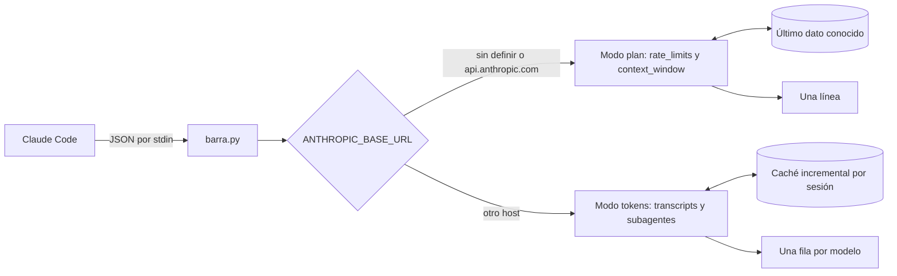

<div align="center">

# 📊 barra-de-uso

**Status line para Claude Code que dice la verdad: cuánto plan te queda, a qué ritmo lo gastas y cuántos tokens usó cada modelo.**


</div>

---

## 🚀 Instalación en un minuto

Necesitas Python 3.12 o superior. Nada que instalar con `pip`.

```bash
git clone https://github.com/CienciaEstelar/barra-de-uso.git
```

Agrega esto a `~/.claude/settings.json` (haz una copia del archivo antes):

```json
"statusLine": {
  "type": "command",
  "command": "python3 /ruta/a/barra-de-uso/barra.py"
}
```

Abre una sesión nueva; las que ya estaban abiertas no toman el cambio. Para desinstalar, borra el bloque `statusLine`.

---

## 📋 Qué muestra

La barra elige el modo sola, según tu `ANTHROPIC_BASE_URL`:

| Modo | Cuándo | Qué muestra |
|---|---|---|
| 🟢 **Plan** | `claude` con tu login: la variable sin definir o apuntando a `api.anthropic.com` | **Contexto** usado, uso de la ventana de **5 h** y de la **semanal** con su **ritmo**, y la hora de reset en **hora de Chile** |
| 🔵 **Otro proveedor** | `ds_mode`, `kimi_mode`, `multi_mode` o cualquier otro host | Una fila **por modelo**, subagentes incluidos, con tokens de entrada, lectura de caché, escritura de caché y salida |

### 🧭 Cómo leer el modo plan

| Símbolo | Significa |
|---|---|
| `42%` verde, amarillo o rojo | Nivel de uso: bajo 50 %, desde 50 %, desde 80 % |
| `▲` rojo | Llevas gastado más % que el % de la ventana que ya pasó (más de 5 puntos) |
| `▼` verde | Llevas gastado menos: vas holgado |
| `=` | Vas parejo con el tiempo, dentro de 5 puntos |
| `~42%` tenue | Sesión recién abierta: último dato conocido, mientras Claude Code entrega el real |
| `ctx 11%` | Cuánto de la ventana de contexto de la sesión está ocupado |

Ejemplo: 42 % usado cuando solo ha pasado el 10 % de las 5 h es `▲`. Es una comparación con el reloj, no una predicción.

### 💸 Por qué los tokens vienen separados

Casi todos los proveedores cobran la **lectura de caché** mucho más barata que la entrada normal. Sumados en un solo número, el costo te saldría inflado. Con las cuatro columnas aplicas la tarifa de tu proveedor (suelen venir en USD por millón de tokens):

```text
costo = (in × P_entrada + cr × P_lectura_caché + cw × P_escritura_caché + out × P_salida) / 1.000.000
```

La barra **no calcula el costo por ti**, a propósito: las tarifas cambian y varían por proveedor; los tokens, no.

---

## ⚙️ Cómo funciona



- **Modo plan:** lee `rate_limits` y `context_window` del JSON que Claude Code ya entrega, convierte `resets_at` a `America/Santiago` y calcula el ritmo con la duración de cada ventana (5 h y 7 días).
- **Último dato conocido:** cada `rate_limits` que llega se guarda en `~/.cache/barra-de-uso/ultimo-plan.json`. Si una sesión nueva todavía no lo recibe, la barra muestra ese valor con `~`; si su reset ya pasó, no lo usa.
- **Modo otro proveedor:** lee el transcript de la sesión y los de sus subagentes (`<sesión>/subagents/**/agent-*.jsonl`), **deduplica por `message.id`** (cada respuesta aparece repetida varias veces en el archivo) y suma por modelo.
- **Caché incremental:** guarda hasta qué byte leyó de cada archivo. Cada refresco procesa solo lo nuevo, así que la barra no se pone lenta aunque la sesión pese cientos de MB.
- **Colores:** ANSI básicos. Cada línea parte con un reinicio, porque Claude Code atenúa el status line. `NO_COLOR=1` los apaga.

---

## ✅ Qué está verificado y qué no

| Qué | Cómo | Resultado |
|---|---|---|
| Formato del payload y `rate_limits` | Capturas reales con Claude Code **2.1.296** | Calza con lo que asume el código |
| Reset semanal | Capturas reales convertidas a hora de Chile | Martes 04:00, como corresponde |
| Totales de tokens | Contra un cálculo independiente con `jq` sobre una sesión real con 39 subagentes | **Idénticos** |
| Velocidad | Transcripts reales | ~0,1 s por refresco; la primera lectura de una sesión de 127 MB tarda 1,4 s, una sola vez |
| Código | `pytest`, más pruebas de mutación | 108 tests; cada error introducido a propósito fue detectado |
| Colores dentro de Claude Code | Prueba en vivo con Claude Code **2.1.306** | ✅ **Funcionan** |

⚠️ Si una versión nueva de Claude Code cambia el formato del payload, la barra no se rompe: cae al nombre del modelo. Los umbrales de color (50 % y 80 %) y el margen del ritmo (5 puntos) son decisiones de diseño, no algo medido.

---

## 🔒 Privacidad y seguridad

Corre en cada refresco de tu terminal, así que el código tiene que ser aburrido:

- **Cero red.** No importa ningún módulo de red (`urllib.parse` solo parsea texto).
- **Cero credenciales.** Nunca abre `~/.claude/.credentials.json` ni toca tu token.
- **Cero procesos.** No lanza subprocesos ni ejecuta comandos.
- **Escribe en un solo lugar:** `~/.cache/barra-de-uso/`.
- **Solo biblioteca estándar.** Sin dependencias que auditar.
- **Nunca rompe tu terminal.** Ante cualquier error imprime el nombre del modelo y sale con código 0.

---

## 🚫 Qué NO hace

- **No calcula costos.** Te da los tokens; tú pones la tarifa.
- **No predice** a qué hora te quedarás sin plan.
- **No muestra el uso semanal por modelo** (Opus, Sonnet) ni el uso extra pagado.
- **No tiene temas ni colores configurables.** Para apagarlos: `"command": "NO_COLOR=1 python3 /ruta/a/barra-de-uso/barra.py"`.
- **La hora de reset siempre sale en `America/Santiago`.**
- **Una sesión reanudada puede contar dos veces** la historia que copió de otra.
- **No traduce alias.** Muestra el modelo tal como lo registra el transcript (por ejemplo `glm-fast`), que puede no ser el nombre comercial.

---

## 🛠️ Para desarrollar

```bash
python3 -m pytest -q                    # tests; los datos son sintéticos, ningún transcript real vive en el repo
python3 docs/assets/generar_imagen.py   # regenera la imagen de arriba desde la salida real de la barra
```

```text
barra-de-uso/
├── barra.py                  # lanzador que ejecuta Claude Code
├── barra_de_uso/
│   ├── entrada.py            # JSON de stdin a Payload, tolerante a campos faltantes
│   ├── modo.py               # plan u otro proveedor
│   ├── plan.py               # línea del modo plan: contexto, ritmo, reset en hora de Chile
│   ├── memoria.py            # último uso del plan conocido entre sesiones
│   ├── color.py              # códigos ANSI y colores por nivel
│   ├── transcripts.py        # lectura incremental, dedupe por message.id, totales por modelo
│   ├── cache.py              # estado por sesión con escritura atómica
│   ├── formato.py            # abreviación (k, M) y tabla alineada
│   └── principal.py          # orquestación y red de seguridad
├── tests/                    # un archivo por módulo, más pruebas de punta a punta
└── docs/
    ├── assets/               # imagen y su generador
    └── superpowers/          # specs de diseño y planes de implementación
```

Configuración, ambas opcionales: `BARRA_DE_USO_CACHE_DIR` cambia dónde se guarda la caché y `NO_COLOR=1` apaga los colores.

---

## 🙏 Créditos

El comportamiento de `rate_limits` y el reinicio ANSI se contrastaron con [`pcvelz/ccstatusline-usage`](https://github.com/pcvelz/ccstatusline-usage) (MIT, TypeScript), un fork de [`sirmalloc/ccstatusline`](https://github.com/sirmalloc/ccstatusline). **No se copió código.** La diferencia de fondo: aquí solo se lee lo que Claude Code ya entrega por stdin, sin tocar tu token OAuth ni llamar a ninguna API.

## 📄 Licencia

[MIT](LICENSE). Úsala, modifícala y compártela libremente; solo conserva el aviso de copyright.

## 👤 Autor

**Juan Galaz** · [@CienciaEstelar](https://github.com/CienciaEstelar) · [cienciaestelar.cl](https://cienciaestelar.cl)

---

<details>
<summary>🇬🇧 English summary</summary>

**barra-de-uso** is a zero-dependency, zero-network Python status line for Claude Code.

- **Plan mode** (`ANTHROPIC_BASE_URL` unset or `api.anthropic.com`): context usage plus 5-hour and weekly usage from the `rate_limits` field Claude Code already passes on stdin, with a pace arrow (▲ more used than time elapsed, ▼ less, = even), color by level, reset times in `America/Santiago`, and the last known value (`~`) while a new session has no data yet.
- **Other-provider mode** (DeepSeek, Kimi, GLM, a local gateway...): one row per model, subagents included, with input, cache-read, cache-write and output tokens kept separate so you can apply each provider's own prices.
- It never reads your credentials, never opens a socket, and on any error prints the model name and exits 0.

Install: clone the repo and set `statusLine.command` to `python3 /path/to/barra-de-uso/barra.py` in `~/.claude/settings.json`. Requires Python 3.12+. Tests: `python3 -m pytest -q`. License: MIT.

</details>
