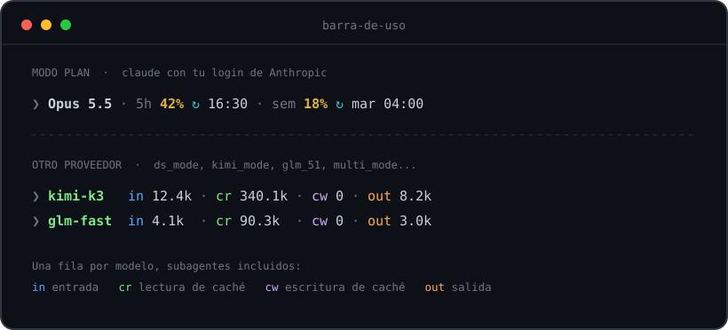
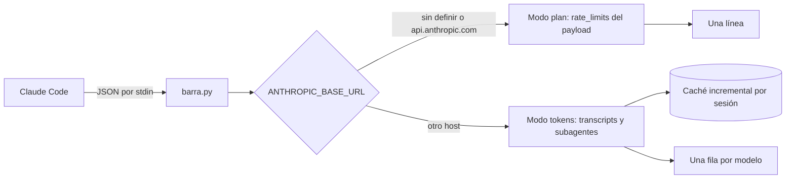

<div align="center">

# 📊 barra-de-uso

**Status line para Claude Code que dice la verdad: cuánto plan te queda y cuántos tokens gastó cada modelo.**




</div>

---

## 📋 Resumen

Si usas Claude Code con más de un proveedor (el plan de Anthropic más DeepSeek, Kimi, GLM, Gemini o un gateway local), la barra de abajo te sirve para cosas distintas según el modo, y `barra-de-uso` se adapta sola:

| Modo | Cómo lo detecta | Qué muestra |
|---|---|---|
| 🟢 **Plan** (`claude` con tu login) | `ANTHROPIC_BASE_URL` sin definir o apuntando a `api.anthropic.com` | Uso de la ventana de **5 h** y de la **semanal**, con la hora de reset en **hora de Chile** |
| 🔵 **Otro proveedor** (`ds_mode`, `kimi_mode`, `multi_mode`...) | Cualquier otro host | Una fila **por modelo** (principal y subagentes) con tokens de entrada, lectura de caché, escritura de caché y salida |

Los tokens vienen separados a propósito: casi todos los proveedores cobran la **lectura de caché** mucho más barata que la entrada normal. Si los sumaras en un solo número, el costo te saldría inflado. Con las cuatro columnas multiplicas cada una por la tarifa de tu proveedor y listo.

```text
costo = in × P_entrada + cr × P_lectura_caché + cw × P_escritura_caché + out × P_salida
```

> 💡 La barra **no calcula el costo por ti**, a propósito. Las tarifas cambian y varían por proveedor; los tokens, no.

---

## 🚀 Instalación

Necesitas Python 3.12 o superior. No hay nada que instalar con `pip`.

**1. Clona el repo**

```bash
git clone https://github.com/CienciaEstelar/barra-de-uso.git
```

**2. Agrega esto a `~/.claude/settings.json`**

```json
"statusLine": {
  "type": "command",
  "command": "python3 /ruta/a/barra-de-uso/barra.py"
}
```

> 🛟 Haz una copia de `settings.json` antes de tocarlo. Es un archivo que Claude Code lee en cada sesión.

**3. Abre una sesión nueva**

Las sesiones que ya estaban abiertas no toman el cambio. Además, Claude Code recién entrega el uso del plan después de la primera respuesta, así que antes verás `5h -- · sem --`. Es normal.

---

## ⚙️ Cómo funciona



- **Modo plan:** no calcula nada. Lee `rate_limits` del JSON que Claude Code ya le entrega y convierte `resets_at` a `America/Santiago`.
- **Modo otro proveedor:** lee el transcript de la sesión y los de sus subagentes (`<sesión>/subagents/**/agent-*.jsonl`), **deduplica por `message.id`** (cada respuesta aparece repetida varias veces en el archivo) y suma por modelo.
- **Caché incremental:** guarda hasta qué byte leyó de cada archivo en `~/.cache/barra-de-uso/<session_id>.json`. Cada refresco procesa solo lo nuevo, así que la barra no se vuelve lenta aunque la sesión pese cientos de MB.

---

## ✅ Qué está verificado (y qué no)

| Qué | Cómo se verificó | Resultado |
|---|---|---|
| Formato del payload y `rate_limits` | Capturas reales con Claude Code **2.1.296** | Calza con lo que asume el código |
| Reset semanal | Capturas reales convertidas a hora de Chile | Martes 04:00, como corresponde |
| Totales de tokens | Contra un cálculo independiente con `jq` sobre una sesión real de `ds_mode` con 39 subagentes | **Idénticos** |
| Velocidad | Medida sobre transcripts reales | ~0,1 s por refresco con caché; la primera lectura de una sesión de 127 MB tarda 1,4 s, una sola vez |
| Código | `pytest` | 65 tests pasando |

⚠️ **Honestidad:** el payload se validó en la 2.1.296. Si una versión nueva de Claude Code cambia el formato, la barra no se rompe: cae al nombre del modelo.

---

## 🔒 Privacidad y seguridad

Esta barra se ejecuta en cada refresco de tu terminal, así que el código tiene que ser aburrido:

- **Cero red.** No importa ningún módulo de red (`urllib.parse` solo parsea texto).
- **Cero credenciales.** Nunca abre `~/.claude/.credentials.json` ni toca tu token.
- **Cero procesos.** No lanza subprocesos ni ejecuta comandos.
- **Solo biblioteca estándar.** Sin dependencias que auditar.
- **Nunca rompe tu terminal.** Ante cualquier error imprime el nombre del modelo y sale con código 0; jamás un traceback.

---

## 🧭 Qué hace y qué NO hace

**Hace**
- Uso del plan de 5 h y semanal, con reset en hora de Chile.
- Tokens por modelo (principal y subagentes) separados en entrada, lectura de caché, escritura de caché y salida.
- Elige el modo solo, según tu `ANTHROPIC_BASE_URL`.

**No hace**
- ❌ **No calcula costos.** Te da los tokens; tú pones la tarifa.
- ❌ **No muestra el uso semanal por modelo** (Opus, Sonnet) ni el uso extra pagado.
- ❌ **No predice** si te alcanza el plan hasta el reset.
- ❌ **No tiene colores configurables ni temas.** Los colores de la imagen de arriba son decorativos; la barra real imprime texto plano.
- ❌ **La hora de reset siempre sale en `America/Santiago`.** No es configurable.
- ❌ **Una sesión reanudada puede contar dos veces** la historia que copió de otra sesión.
- ❌ **No sabe qué es un "alias".** Muestra el nombre del modelo tal como lo registra el transcript (por ejemplo `glm-fast`), que puede no ser el nombre comercial.

---

## 🧪 Tests

```bash
python3 -m pytest -q
```

Los datos de prueba son **sintéticos**: ningún transcript real vive en el repo.

---

## 📂 Estructura

```text
barra-de-uso/
├── barra.py                  # lanzador que ejecuta Claude Code
├── barra_de_uso/
│   ├── entrada.py            # JSON de stdin a Payload, tolerante a campos faltantes
│   ├── modo.py               # plan u otro proveedor
│   ├── plan.py               # línea del modo plan, reset en hora de Chile
│   ├── transcripts.py        # lectura incremental, dedupe por message.id, totales por modelo
│   ├── cache.py              # estado por sesión con escritura atómica
│   ├── formato.py            # abreviación (k, M) y tabla alineada
│   └── principal.py          # orquestación y red de seguridad
├── tests/                    # un archivo por módulo, más pruebas de punta a punta
└── docs/
    ├── assets/               # la imagen de arriba, generada con el propio código
    └── superpowers/          # spec de diseño y plan de implementación
```

La única configuración es una variable de entorno opcional: `BARRA_DE_USO_CACHE_DIR` cambia dónde se guarda la caché.

---

## 🙏 Créditos

El comportamiento de `rate_limits` se contrastó con [`pcvelz/ccstatusline-usage`](https://github.com/pcvelz/ccstatusline-usage) (MIT, TypeScript), un fork de [`sirmalloc/ccstatusline`](https://github.com/sirmalloc/ccstatusline). **No se copió código.** Aquí la decisión fue distinta: leer solo lo que Claude Code ya entrega por stdin, sin tocar tu token OAuth ni llamar a ninguna API.

## 👤 Autor

**Juan Galaz** · [@CienciaEstelar](https://github.com/CienciaEstelar) · [cienciaestelar.cl](https://cienciaestelar.cl)

---

<details>
<summary>🇬🇧 English summary</summary>

**barra-de-uso** is a zero-dependency, zero-network Python status line for Claude Code.

- **Plan mode** (`ANTHROPIC_BASE_URL` unset or `api.anthropic.com`): 5-hour and weekly usage from the `rate_limits` field Claude Code already passes on stdin, with reset times shown in `America/Santiago`.
- **Other-provider mode** (DeepSeek, Kimi, GLM, a local gateway...): one row per model, subagents included, with input, cache-read, cache-write and output tokens kept separate so you can apply each provider's own prices.
- It never reads your credentials, never opens a socket, and on any error prints the model name and exits 0.

Install: clone the repo and set `statusLine.command` to `python3 /path/to/barra-de-uso/barra.py` in `~/.claude/settings.json`. Requires Python 3.12+. Tests: `python3 -m pytest -q`.

</details>
