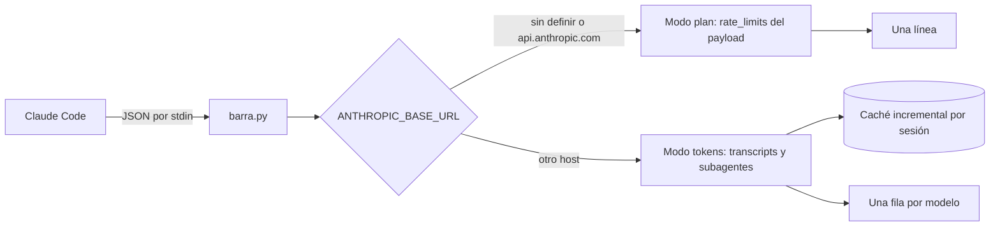

# barra-de-uso v2 Implementation Plan

> **For agentic workers:** REQUIRED SUB-SKILL: Use superpowers:subagent-driven-development (recommended) or superpowers:executing-plans to implement this plan task-by-task. Steps use checkbox (`- [ ]`) syntax for tracking.

**Goal:** Agregar a `barra-de-uso` ritmo (`▲ ▼ =`), colores por gravedad, contexto (`ctx`) y último dato conocido (`~`) al abrir una sesión.

**Architecture:** Dos módulos nuevos (`color.py` para ANSI, `memoria.py` para el último `rate_limits` visto) y cambios acotados en `entrada.py`, `plan.py`, `formato.py` y `principal.py`. Los colores se activan por defecto y se apagan con `NO_COLOR`. La imagen del README pasa a generarse con un script versionado que traduce la salida ANSI real a SVG.

**Tech Stack:** Python 3.12 solo stdlib; pytest 7.4.

**Spec:** `docs/superpowers/specs/2026-10-21-barra-de-uso-v2-design.md`. Leerlo completo antes de empezar.

---

## Reglas para quien implementa

- Raíz del repo: `/home/juan-galaz/Escritorio/Proyectos/barra-de-uso`. Todos los comandos se corren desde ahí. Rama `main`, que hoy está en sincronía con `origin/main`.
- Convenciones de `~/Escritorio/Proyectos/CLAUDE.md`: nombres y comentarios en español, sin `except:` desnudo, sin em dashes (carácter U+2014), tests con pytest.
- Repo **público**: nada de datos reales de Juan en archivos versionados.
- El código de este plan ya fue escrito, probado (108 tests, pruebas de mutación) y **simulado tarea por tarea** sobre una copia del repo. **Copiarlo tal cual.** Si un resultado no coincide con el "Expected", detenerse y reportar.
- Cada paso indica si se **reemplaza el archivo completo** o se **crea**. No hay ediciones parciales.
- **La barra ya está instalada** en `~/.claude/settings.json` apuntando a este repo: los cambios se ven en vivo en la terminal de Juan. Por eso cada tarea termina con la suite completa en verde.
- No modificar `~/.claude/settings.json`. No hacer `git push` sin el OK explícito de Juan (Task 8).
- Comunicación con Juan: español chileno casual.

## Mapa de archivos

| Archivo | Acción | Responsabilidad |
|---|---|---|
| `barra_de_uso/color.py` | crear | códigos ANSI, `pintar`, `color_nivel`, `colores_activos` |
| `barra_de_uso/memoria.py` | crear | cargar, guardar y aplicar el último `rate_limits` conocido |
| `barra_de_uso/entrada.py` | reemplazar | `Ventana.estimada`, `Payload.contexto` |
| `barra_de_uso/plan.py` | reemplazar | ritmo, contexto, ventana estimada, colores |
| `barra_de_uso/formato.py` | reemplazar | colores en la tabla sin alterar la alineación |
| `barra_de_uso/principal.py` | reemplazar | memoria en modo plan, colores, reinicio ANSI por línea |
| `tests/conftest.py` | reemplazar | agrega `sin_ansi()` |
| `tests/test_color.py`, `tests/test_memoria.py` | crear | tests nuevos |
| `tests/test_entrada.py`, `tests/test_plan.py`, `tests/test_formato.py`, `tests/test_principal.py` | reemplazar | tests actualizados |
| `docs/assets/generar_imagen.py` | crear | SVG del README desde la salida ANSI real |
| `docs/assets/barra-de-uso.svg`, `README.md` | reemplazar | documentación |

---

### Task 1: Colores (`color.py`)

**Files:**
- Replace: `tests/conftest.py`
- Create: `tests/test_color.py`, `barra_de_uso/color.py`

- [ ] **Step 1: Reemplazar `tests/conftest.py`** (agrega `sin_ansi`)

```python
"""Ayudantes para armar transcripts SINTÉTICOS. Nunca usar datos reales: el repo es público."""

import json
import re
from pathlib import Path

import pytest


def respuesta(id_mensaje, modelo, entrada=0, cache_lectura=0, cache_escritura=0, salida=0, **extra):
    """Una línea 'assistant' con la misma forma que escribe Claude Code."""
    linea = {
        "type": "assistant",
        "message": {
            "id": id_mensaje,
            "model": modelo,
            "usage": {
                "input_tokens": entrada,
                "cache_read_input_tokens": cache_lectura,
                "cache_creation_input_tokens": cache_escritura,
                "output_tokens": salida,
            },
        },
    }
    linea.update(extra)
    return linea


def escribir_jsonl(ruta: Path, lineas, final_incompleto: str = "") -> Path:
    ruta.parent.mkdir(parents=True, exist_ok=True)
    texto = "".join(json.dumps(linea) + "\n" for linea in lineas) + final_incompleto
    ruta.write_text(texto, encoding="utf-8")
    return ruta


def agregar_jsonl(ruta: Path, lineas) -> None:
    with ruta.open("a", encoding="utf-8") as archivo:
        for linea in lineas:
            archivo.write(json.dumps(linea) + "\n")


def sin_ansi(texto: str) -> str:
    return re.sub(r"\x1b\[[0-9;]*m", "", texto)


@pytest.fixture
def cache_temporal(tmp_path, monkeypatch):
    carpeta = tmp_path / "cache"
    monkeypatch.setenv("BARRA_DE_USO_CACHE_DIR", str(carpeta))
    return carpeta
```

- [ ] **Step 2: Crear `tests/test_color.py`**

```python
import pytest

from barra_de_uso.color import AMARILLO, NEGRITA, REINICIO, ROJO, VERDE, color_nivel, colores_activos, pintar


def test_pintar_inactivo_devuelve_el_texto_tal_cual():
    assert pintar("42%", ROJO, activo=False) == "42%"


def test_pintar_activo_envuelve_y_reinicia():
    assert pintar("42%", ROJO, activo=True) == "\x1b[31m42%" + REINICIO


def test_pintar_varios_codigos():
    assert pintar("kimi", NEGRITA, VERDE, activo=True) == "\x1b[1;32mkimi" + REINICIO


def test_pintar_sin_codigos_o_texto_vacio_no_agrega_nada():
    assert pintar("=", activo=True) == "="
    assert pintar("", ROJO, activo=True) == ""


@pytest.mark.parametrize("porcentaje, esperado", [
    (0, VERDE),
    (49.9, VERDE),
    (50, AMARILLO),
    (79.9, AMARILLO),
    (80, ROJO),
    (100, ROJO),
])
def test_color_nivel(porcentaje, esperado):
    assert color_nivel(porcentaje) == esperado


def test_no_color_desactiva_colores():
    assert colores_activos({}) is True
    assert colores_activos({"NO_COLOR": ""}) is True  # vacía no cuenta, según no-color.org
    assert colores_activos({"NO_COLOR": "1"}) is False
```

- [ ] **Step 3: Verificar que falla**

Run: `python3 -m pytest tests/test_color.py -q`
Expected: `1 error` (ModuleNotFoundError: No module named 'barra_de_uso.color')

- [ ] **Step 4: Crear `barra_de_uso/color.py`**

```python
"""Códigos ANSI mínimos. Sin colores si NO_COLOR está definida y no vacía (no-color.org)."""

from __future__ import annotations

from collections.abc import Mapping

# Claude Code atenúa (dim) el status line: cada línea parte con un reinicio para que
# los colores se vean con su intensidad real.
REINICIO = "\x1b[0m"

NEGRITA = "1"
TENUE = "2"
ROJO = "31"
VERDE = "32"
AMARILLO = "33"
AZUL = "34"
MAGENTA = "35"
CIAN = "36"

UMBRAL_AMARILLO = 50
UMBRAL_ROJO = 80


def colores_activos(entorno: Mapping[str, str]) -> bool:
    return not entorno.get("NO_COLOR")


def pintar(texto: str, *codigos: str, activo: bool) -> str:
    if not activo or not codigos or not texto:
        return texto
    return f"\x1b[{';'.join(codigos)}m{texto}{REINICIO}"


def color_nivel(porcentaje: float) -> str:
    """Verde bajo 50 %, amarillo desde 50 %, rojo desde 80 %."""
    if porcentaje >= UMBRAL_ROJO:
        return ROJO
    if porcentaje >= UMBRAL_AMARILLO:
        return AMARILLO
    return VERDE
```

- [ ] **Step 5: Verificar**

Run: `python3 -m pytest tests/test_color.py -q` → Expected: `11 passed`
Run: `python3 -m pytest -q` → Expected: `76 passed`

- [ ] **Step 6: Commit**

```bash
git add tests/conftest.py tests/test_color.py barra_de_uso/color.py
git commit -m "feat: modulo de colores ANSI con NO_COLOR"
```

---

### Task 2: Contexto y ventana estimada en el payload (`entrada.py`)

**Files:**
- Replace: `tests/test_entrada.py`, `barra_de_uso/entrada.py`

- [ ] **Step 1: Reemplazar `tests/test_entrada.py`**

```python
import json

import pytest

from barra_de_uso.entrada import NOMBRE_RESPALDO, Ventana, parsear_payload


def test_payload_completo():
    texto = json.dumps({
        "model": {"id": "claude-opus-5-5", "display_name": "Opus 5.5"},
        "session_id": "abc-123",
        "transcript_path": "/tmp/x.jsonl",
        "rate_limits": {
            "five_hour": {"used_percentage": 42, "resets_at": 1774020000},
            "seven_day": {"used_percentage": 15.5, "resets_at": "1774540000"},
        },
    })
    payload = parsear_payload(texto)
    assert payload.modelo == "Opus 5.5"
    assert payload.session_id == "abc-123"
    assert payload.transcript_path == "/tmp/x.jsonl"
    assert payload.cinco_horas == Ventana(42.0, 1774020000.0)
    assert payload.semanal == Ventana(15.5, 1774540000.0)


def test_usa_id_si_falta_display_name():
    assert parsear_payload('{"model": {"id": "deepseek-flash"}}').modelo == "deepseek-flash"


def test_objeto_vacio_usa_nombre_de_respaldo():
    payload = parsear_payload("{}")
    assert payload.modelo == NOMBRE_RESPALDO
    assert payload.session_id is None
    assert payload.transcript_path is None
    assert payload.cinco_horas is None
    assert payload.semanal is None


def test_rate_limits_null():
    payload = parsear_payload('{"rate_limits": null}')
    assert payload.cinco_horas is None
    assert payload.semanal is None


def test_valores_invalidos_quedan_en_none():
    texto = json.dumps({"rate_limits": {"five_hour": {"used_percentage": "nada", "resets_at": True}}})
    assert parsear_payload(texto).cinco_horas == Ventana(None, None)


def test_nan_queda_en_none():
    texto = json.dumps({"rate_limits": {"five_hour": {"used_percentage": "nan"}}})
    assert parsear_payload(texto).cinco_horas == Ventana(None, None)


def test_json_invalido_lanza_value_error():
    with pytest.raises(ValueError):
        parsear_payload("esto no es json")


def test_json_que_no_es_objeto_lanza_value_error():
    with pytest.raises(ValueError):
        parsear_payload("[1, 2]")


def test_contexto_se_lee_de_context_window():
    texto = json.dumps({"context_window": {"used_percentage": 11, "context_window_size": 1000000}})
    assert parsear_payload(texto).contexto == 11.0


def test_contexto_null_en_el_primer_refresco():
    assert parsear_payload('{"context_window": {"used_percentage": null}}').contexto is None
    assert parsear_payload("{}").contexto is None


def test_ventana_del_payload_nunca_es_estimada():
    texto = json.dumps({"rate_limits": {"five_hour": {"used_percentage": 42, "resets_at": 1}}})
    assert parsear_payload(texto).cinco_horas.estimada is False
```

- [ ] **Step 2: Verificar que falla**

Run: `python3 -m pytest tests/test_entrada.py -q`
Expected: `3 failed, 8 passed` (AttributeError: no existen `contexto` ni `estimada`)

- [ ] **Step 3: Reemplazar `barra_de_uso/entrada.py`**

```python
"""Parseo tolerante del JSON que Claude Code entrega por stdin al status line."""

from __future__ import annotations

import json
import math
from dataclasses import dataclass

NOMBRE_RESPALDO = "barra-de-uso"


@dataclass(frozen=True)
class Ventana:
    """Una ventana de rate limit: porcentaje usado y momento del reset (epoch en segundos).

    `estimada` es True cuando el dato viene de la memoria y no del payload actual.
    """

    porcentaje: float | None
    reset_epoch: float | None
    estimada: bool = False


@dataclass(frozen=True)
class Payload:
    modelo: str
    session_id: str | None
    transcript_path: str | None
    cinco_horas: Ventana | None
    semanal: Ventana | None
    contexto: float | None = None


def _numero(valor: object) -> float | None:
    # resets_at y used_percentage pueden llegar como número o como string.
    if isinstance(valor, bool):
        return None
    if isinstance(valor, (int, float)):
        numero = float(valor)
    elif isinstance(valor, str):
        try:
            numero = float(valor)
        except ValueError:
            return None
    else:
        return None
    return numero if math.isfinite(numero) else None


def _texto(valor: object) -> str | None:
    return valor if isinstance(valor, str) and valor else None


def _diccionario(valor: object) -> dict:
    return valor if isinstance(valor, dict) else {}


def _ventana(valor: object) -> Ventana | None:
    if not isinstance(valor, dict):
        return None
    return Ventana(_numero(valor.get("used_percentage")), _numero(valor.get("resets_at")))


def parsear_payload(texto: str) -> Payload:
    """Convierte el JSON de stdin en un Payload. Lanza ValueError si no es un objeto JSON."""
    datos = json.loads(texto)
    if not isinstance(datos, dict):
        raise ValueError("el payload no es un objeto JSON")
    info_modelo = _diccionario(datos.get("model"))
    modelo = _texto(info_modelo.get("display_name")) or _texto(info_modelo.get("id")) or NOMBRE_RESPALDO
    limites = _diccionario(datos.get("rate_limits"))
    contexto = _diccionario(datos.get("context_window"))
    return Payload(
        modelo=modelo,
        session_id=_texto(datos.get("session_id")),
        transcript_path=_texto(datos.get("transcript_path")),
        cinco_horas=_ventana(limites.get("five_hour")),
        semanal=_ventana(limites.get("seven_day")),
        # Viene null en el primer refresco, antes de la primera respuesta.
        contexto=_numero(contexto.get("used_percentage")),
    )
```

- [ ] **Step 4: Verificar**

Run: `python3 -m pytest tests/test_entrada.py -q` → Expected: `11 passed`
Run: `python3 -m pytest -q` → Expected: `79 passed`

- [ ] **Step 5: Commit**

```bash
git add tests/test_entrada.py barra_de_uso/entrada.py
git commit -m "feat: contexto y ventana estimada en el payload"
```

---

### Task 3: Ritmo, contexto y colores en la línea del plan (`plan.py`)

**Files:**
- Replace: `tests/test_plan.py`, `barra_de_uso/plan.py`

Nota: en `test_linea_plan_completa`, la ventana de 5 h lleva transcurrido el 10 % (quedan 4,5 h de 5) con 42 % usado, así que da `▲`. La semanal lleva el 19 % (quedan 136 h de 168) con 18 % usado, así que da `=`.

- [ ] **Step 1: Reemplazar `tests/test_plan.py`**

```python
from datetime import datetime, timezone

import pytest

from barra_de_uso.entrada import Payload, Ventana
from barra_de_uso.plan import flecha_ritmo, formatear_contexto, formatear_reset, formatear_ventana, linea_plan
from tests.conftest import sin_ansi


def epoch_utc(*partes):
    return datetime(*partes, tzinfo=timezone.utc).timestamp()


# Miércoles 21-oct-2026 12:00 hora de Chile (UTC-3 en horario de verano).
AHORA = datetime(2026, 10, 21, 15, 0, tzinfo=timezone.utc)
RESET_5H = epoch_utc(2026, 10, 21, 19, 30)  # 16:30 en Chile: quedan 4,5 h de 5, transcurrió el 10 %
RESET_SEM = epoch_utc(2026, 10, 27, 7, 0)  # martes 04:00 en Chile: quedan 136 h de 168, transcurrió el 19 %


def test_reset_hoy_muestra_solo_hora():
    assert formatear_reset(RESET_5H, AHORA) == "16:30"


def test_reset_martes_04_00_horario_de_verano():
    # 27-oct-2026 es martes; Chile en UTC-3, así que 04:00 local = 07:00 UTC.
    assert formatear_reset(RESET_SEM, AHORA) == "mar 04:00"


def test_reset_martes_04_00_horario_de_invierno():
    # 16-jun-2026 es martes; Chile en UTC-4, así que 04:00 local = 08:00 UTC.
    ahora = datetime(2026, 6, 12, 15, 0, tzinfo=timezone.utc)
    assert formatear_reset(epoch_utc(2026, 6, 16, 8, 0), ahora) == "mar 04:00"


def test_dia_con_tilde():
    # 24-oct-2026 es sábado.
    assert formatear_reset(epoch_utc(2026, 10, 24, 15, 0), AHORA) == "sáb 12:00"


def test_fecha_se_compara_en_hora_de_chile_no_utc():
    # 22-oct 02:00 UTC todavía es 21-oct 23:00 en Chile: cuenta como hoy.
    assert formatear_reset(epoch_utc(2026, 10, 22, 2, 0), AHORA) == "23:00"


# Ventana de 100 s con 50 s restantes: transcurrió el 50 %.
@pytest.mark.parametrize("porcentaje, esperado", [
    (60, "▲"),
    (55.1, "▲"),
    (55, "="),  # justo en el margen de 5 puntos
    (50, "="),
    (45, "="),
    (44.9, "▼"),
    (10, "▼"),
])
def test_flecha_ritmo(porcentaje, esperado):
    assert flecha_ritmo(porcentaje, reset_epoch=1050, duracion=100, ahora_epoch=1000) == esperado


def test_flecha_ritmo_reset_vencido_cuenta_ventana_completa():
    assert flecha_ritmo(90, reset_epoch=900, duracion=100, ahora_epoch=1000) == "▼"


def test_flecha_ritmo_reset_mas_lejos_que_la_ventana_cuenta_cero():
    assert flecha_ritmo(3, reset_epoch=5000, duracion=100, ahora_epoch=1000) == "="
    assert flecha_ritmo(6, reset_epoch=5000, duracion=100, ahora_epoch=1000) == "▲"


def test_ventana_con_porcentaje_fraccional_sin_reset_no_lleva_flecha():
    assert formatear_ventana("5h", Ventana(23.6, None), AHORA) == "5h 24%"


def test_ventana_con_reset_lleva_flecha():
    assert formatear_ventana("5h", Ventana(42, RESET_5H), AHORA) == "5h 42% ▲ ↻ 16:30"


def test_ventana_sin_porcentaje():
    assert formatear_ventana("sem", Ventana(None, RESET_SEM), AHORA) == "sem --"


def test_ventana_ausente():
    assert formatear_ventana("5h", None, AHORA) == "5h --"


def test_ventana_estimada_lleva_tilde_y_no_lleva_flecha():
    assert formatear_ventana("5h", Ventana(42, RESET_5H, estimada=True), AHORA) == "5h ~42% ↻ 16:30"
    assert formatear_ventana("5h", Ventana(42, None, estimada=True), AHORA) == "5h ~42%"


def test_ventana_estimada_con_colores_va_tenue_completa():
    texto = formatear_ventana("5h", Ventana(42, RESET_5H, estimada=True), AHORA, colores=True)
    assert texto == "\x1b[2m5h ~42% ↻ 16:30\x1b[0m"


def test_contexto():
    assert formatear_contexto(11.4) == "ctx 11%"
    assert formatear_contexto(85, colores=True) == "ctx \x1b[31m85%\x1b[0m"


def test_linea_plan_completa():
    payload = Payload("Opus 5.5", None, None, Ventana(42, RESET_5H), Ventana(18, RESET_SEM))
    assert linea_plan(payload, AHORA) == "Opus 5.5 · 5h 42% ▲ ↻ 16:30 · sem 18% = ↻ mar 04:00"


def test_linea_plan_con_contexto():
    payload = Payload("Opus 5.5", None, None, None, None, contexto=11)
    assert linea_plan(payload, AHORA) == "Opus 5.5 · ctx 11% · 5h -- · sem --"


def test_linea_plan_sin_rate_limits():
    payload = Payload("Opus 5.5", None, None, None, None)
    assert linea_plan(payload, AHORA) == "Opus 5.5 · 5h -- · sem --"


def test_linea_plan_con_colores_es_la_misma_sin_ansi():
    payload = Payload("Opus 5.5", None, None, Ventana(42, RESET_5H), Ventana(18, RESET_SEM), contexto=85)
    plano = linea_plan(payload, AHORA)
    coloreado = linea_plan(payload, AHORA, colores=True)
    assert sin_ansi(coloreado) == plano
    assert "\x1b[32m42%" in coloreado  # nivel bajo: verde
    assert "\x1b[31m▲" in coloreado  # adelantado: rojo
    assert "\x1b[31m85%" in coloreado  # contexto alto: rojo
    assert "\x1b[2m · \x1b[0m" in coloreado  # separadores tenues
```

- [ ] **Step 2: Verificar que falla**

Run: `python3 -m pytest tests/test_plan.py -q`
Expected: `1 error` (ImportError: cannot import name 'flecha_ritmo')

- [ ] **Step 3: Reemplazar `barra_de_uso/plan.py`**

```python
"""Línea del modo plan: contexto, uso de 5 h y semanal con ritmo, reset en hora de Chile."""

from __future__ import annotations

from datetime import datetime
from zoneinfo import ZoneInfo

from barra_de_uso.color import ROJO, TENUE, VERDE, color_nivel, pintar
from barra_de_uso.entrada import Payload, Ventana

# Se resuelve dentro de la función para que un tzdata faltante caiga en la red de seguridad.
ZONA_CHILE = "America/Santiago"
DIAS = ("lun", "mar", "mié", "jue", "vie", "sáb", "dom")
SEPARADOR = " · "

DURACION_SEGUNDOS = {"5h": 5 * 3600, "sem": 7 * 24 * 3600}
# Margen en puntos porcentuales antes de declarar que vas adelantado o holgado.
TOLERANCIA_RITMO = 5
ADELANTADO, HOLGADO, AL_RITMO = "▲", "▼", "="
# Ir al ritmo no es una advertencia: sin color.
COLOR_FLECHA = {ADELANTADO: (ROJO,), HOLGADO: (VERDE,), AL_RITMO: ()}


def formatear_reset(reset_epoch: float, ahora: datetime) -> str:
    """Solo HH:MM si el reset cae hoy (hora de Chile); si no, día abreviado y HH:MM."""
    zona = ZoneInfo(ZONA_CHILE)
    reset = datetime.fromtimestamp(reset_epoch, zona)
    hora = reset.strftime("%H:%M")
    if reset.date() == ahora.astimezone(zona).date():
        return hora
    return f"{DIAS[reset.weekday()]} {hora}"


def flecha_ritmo(porcentaje: float, reset_epoch: float, duracion: float, ahora_epoch: float) -> str:
    """Compara el % usado con el % de la ventana que ya transcurrió.

    ▲ si consumes más rápido que el tiempo, ▼ si vas holgado, = si vas dentro del margen.
    """
    restante = reset_epoch - ahora_epoch
    transcurrido = min(max((duracion - restante) / duracion, 0.0), 1.0) * 100
    diferencia = porcentaje - transcurrido
    if diferencia > TOLERANCIA_RITMO:
        return ADELANTADO
    if diferencia < -TOLERANCIA_RITMO:
        return HOLGADO
    return AL_RITMO


def formatear_ventana(etiqueta: str, ventana: Ventana | None, ahora: datetime, colores: bool = False) -> str:
    if ventana is None or ventana.porcentaje is None:
        return f"{etiqueta} --"
    porcentaje = f"{round(ventana.porcentaje)}%"
    reset = None if ventana.reset_epoch is None else formatear_reset(ventana.reset_epoch, ahora)
    if ventana.estimada:
        # Dato de la memoria: con "~" para que se entienda sin colores, tenue y sin ritmo.
        texto = f"{etiqueta} ~{porcentaje}" + (f" ↻ {reset}" if reset else "")
        return pintar(texto, TENUE, activo=colores)
    partes = [etiqueta, pintar(porcentaje, color_nivel(ventana.porcentaje), activo=colores)]
    if ventana.reset_epoch is not None:
        flecha = flecha_ritmo(ventana.porcentaje, ventana.reset_epoch, DURACION_SEGUNDOS[etiqueta], ahora.timestamp())
        partes.append(pintar(flecha, *COLOR_FLECHA[flecha], activo=colores))
        partes.append(f"↻ {reset}")
    return " ".join(partes)


def formatear_contexto(contexto: float, colores: bool = False) -> str:
    return "ctx " + pintar(f"{round(contexto)}%", color_nivel(contexto), activo=colores)


def linea_plan(payload: Payload, ahora: datetime, colores: bool = False) -> str:
    """`ahora` debe ser un datetime con zona horaria."""
    partes = [payload.modelo]
    if payload.contexto is not None:
        partes.append(formatear_contexto(payload.contexto, colores))
    partes.append(formatear_ventana("5h", payload.cinco_horas, ahora, colores))
    partes.append(formatear_ventana("sem", payload.semanal, ahora, colores))
    return pintar(SEPARADOR, TENUE, activo=colores).join(partes)
```

- [ ] **Step 4: Verificar**

Run: `python3 -m pytest tests/test_plan.py -q` → Expected: `25 passed`
Run: `python3 -m pytest -q` → Expected: `94 passed`

- [ ] **Step 5: Commit**

```bash
git add tests/test_plan.py barra_de_uso/plan.py
git commit -m "feat: ritmo, contexto y colores en la linea del plan"
```

---

### Task 4: Último dato conocido (`memoria.py`)

**Files:**
- Create: `tests/test_memoria.py`, `barra_de_uso/memoria.py`

- [ ] **Step 1: Crear `tests/test_memoria.py`**

```python
import json
import os

from barra_de_uso.entrada import Payload, Ventana
from barra_de_uso.memoria import (
    VERSION,
    cargar_memoria,
    completar_con_memoria,
    guardar_memoria,
    ruta_memoria,
)

AHORA = 1_800_000_000.0
FUTURO = AHORA + 3600
PASADO = AHORA - 60


def payload(cinco_horas=None, semanal=None):
    return Payload("Opus 5.5", None, None, cinco_horas, semanal)


def test_ruta_memoria_usa_carpeta_de_cache(cache_temporal):
    assert ruta_memoria() == cache_temporal / "ultimo-plan.json"


def test_guardar_y_cargar_ida_y_vuelta(cache_temporal):
    ruta = ruta_memoria()
    guardar_memoria(ruta, payload(Ventana(42, FUTURO), Ventana(18, FUTURO + 99)), {})
    assert cargar_memoria(ruta) == {"cinco_horas": Ventana(42.0, FUTURO), "semanal": Ventana(18.0, FUTURO + 99)}


def test_no_guarda_ventana_sin_reset_ni_estimada(cache_temporal):
    ruta = ruta_memoria()
    guardar_memoria(ruta, payload(Ventana(42, None), Ventana(18, FUTURO, estimada=True)), {})
    assert not ruta.exists()


def test_conserva_la_ventana_que_no_viene(cache_temporal):
    ruta = ruta_memoria()
    previa = {"semanal": Ventana(18.0, FUTURO)}
    guardar_memoria(ruta, payload(cinco_horas=Ventana(42, FUTURO)), previa)
    assert cargar_memoria(ruta) == {"cinco_horas": Ventana(42.0, FUTURO), "semanal": Ventana(18.0, FUTURO)}


def test_no_reescribe_si_nada_cambio(cache_temporal):
    ruta = ruta_memoria()
    guardar_memoria(ruta, payload(Ventana(42, FUTURO)), {})
    os.utime(ruta, ns=(1_000_000_000, 1_000_000_000))  # marca antigua conocida
    guardar_memoria(ruta, payload(Ventana(42, FUTURO)), cargar_memoria(ruta))
    assert ruta.stat().st_mtime_ns == 1_000_000_000


def test_memoria_corrupta_o_de_otra_version_queda_vacia(cache_temporal):
    cache_temporal.mkdir()
    ruta = ruta_memoria()
    ruta.write_text("{roto", encoding="utf-8")
    assert cargar_memoria(ruta) == {}
    ruta.write_text(json.dumps({"version": VERSION + 1, "cinco_horas": {"porcentaje": 1, "reset_epoch": FUTURO}}), encoding="utf-8")
    assert cargar_memoria(ruta) == {}
    ruta.write_text(json.dumps({"version": VERSION, "cinco_horas": {"porcentaje": "x", "reset_epoch": FUTURO}}), encoding="utf-8")
    assert cargar_memoria(ruta) == {}


def test_completar_rellena_lo_que_falta_como_estimado():
    memoria = {"cinco_horas": Ventana(42.0, FUTURO), "semanal": Ventana(18.0, FUTURO)}
    resultado = completar_con_memoria(payload(), memoria, AHORA)
    assert resultado.cinco_horas == Ventana(42.0, FUTURO, estimada=True)
    assert resultado.semanal == Ventana(18.0, FUTURO, estimada=True)


def test_completar_no_pisa_el_dato_real():
    memoria = {"cinco_horas": Ventana(10.0, FUTURO)}
    real = Ventana(42, FUTURO)
    assert completar_con_memoria(payload(cinco_horas=real), memoria, AHORA).cinco_horas == real


def test_completar_ignora_memoria_vencida():
    memoria = {"cinco_horas": Ventana(42.0, PASADO)}
    assert completar_con_memoria(payload(), memoria, AHORA).cinco_horas is None


def test_completar_rellena_ventana_sin_porcentaje():
    memoria = {"semanal": Ventana(18.0, FUTURO)}
    resultado = completar_con_memoria(payload(semanal=Ventana(None, FUTURO)), memoria, AHORA)
    assert resultado.semanal == Ventana(18.0, FUTURO, estimada=True)
```

- [ ] **Step 2: Verificar que falla**

Run: `python3 -m pytest tests/test_memoria.py -q`
Expected: `1 error` (ModuleNotFoundError: No module named 'barra_de_uso.memoria')

- [ ] **Step 3: Crear `barra_de_uso/memoria.py`**

```python
"""Último uso del plan conocido, para no mostrar '--' mientras la sesión no recibe su primera respuesta."""

from __future__ import annotations

import dataclasses
import json
from pathlib import Path

from barra_de_uso.cache import carpeta_cache, guardar
from barra_de_uso.entrada import Payload, Ventana

VERSION = 1
NOMBRE_ARCHIVO = "ultimo-plan.json"
CLAVES = ("cinco_horas", "semanal")


def ruta_memoria() -> Path:
    return carpeta_cache() / NOMBRE_ARCHIVO


def _es_numero(valor: object) -> bool:
    return isinstance(valor, (int, float)) and not isinstance(valor, bool)


def cargar_memoria(ruta: Path) -> dict[str, Ventana]:
    """Archivo ausente, corrupto o de otra versión: memoria vacía."""
    try:
        datos = json.loads(ruta.read_text(encoding="utf-8"))
    except (OSError, ValueError):
        return {}
    if not isinstance(datos, dict) or datos.get("version") != VERSION:
        return {}
    memoria = {}
    for clave in CLAVES:
        ventana = datos.get(clave)
        if not isinstance(ventana, dict):
            continue
        porcentaje = ventana.get("porcentaje")
        reset_epoch = ventana.get("reset_epoch")
        if _es_numero(porcentaje) and _es_numero(reset_epoch):
            memoria[clave] = Ventana(float(porcentaje), float(reset_epoch))
    return memoria


def guardar_memoria(ruta: Path, payload: Payload, memoria: dict[str, Ventana]) -> None:
    """Guarda las ventanas con dato real del payload; conserva las demás. No reescribe si nada cambió."""
    nueva = dict(memoria)
    for clave in CLAVES:
        ventana = getattr(payload, clave)
        if ventana is not None and not ventana.estimada and ventana.porcentaje is not None and ventana.reset_epoch is not None:
            nueva[clave] = Ventana(ventana.porcentaje, ventana.reset_epoch)
    if nueva == memoria:
        return
    datos: dict = {"version": VERSION}
    for clave, ventana in nueva.items():
        datos[clave] = {"porcentaje": ventana.porcentaje, "reset_epoch": ventana.reset_epoch}
    guardar(ruta, datos)


def completar_con_memoria(payload: Payload, memoria: dict[str, Ventana], ahora_epoch: float) -> Payload:
    """Rellena las ventanas sin dato con la memoria, marcadas como estimadas, si su reset aún no pasa."""
    cambios = {}
    for clave in CLAVES:
        actual = getattr(payload, clave)
        if actual is not None and actual.porcentaje is not None:
            continue
        recordada = memoria.get(clave)
        if recordada is not None and recordada.reset_epoch > ahora_epoch:
            cambios[clave] = dataclasses.replace(recordada, estimada=True)
    return dataclasses.replace(payload, **cambios) if cambios else payload
```

- [ ] **Step 4: Verificar**

Run: `python3 -m pytest tests/test_memoria.py -q` → Expected: `10 passed`
Run: `python3 -m pytest -q` → Expected: `104 passed`

- [ ] **Step 5: Commit**

```bash
git add tests/test_memoria.py barra_de_uso/memoria.py
git commit -m "feat: memoria del ultimo uso del plan entre sesiones"
```

---

### Task 5: Colores en la tabla de tokens (`formato.py`)

**Files:**
- Replace: `tests/test_formato.py`, `barra_de_uso/formato.py`

- [ ] **Step 1: Reemplazar `tests/test_formato.py`**

```python
import pytest

from barra_de_uso.formato import abreviar, tabla_tokens
from tests.conftest import sin_ansi


@pytest.mark.parametrize("n, esperado", [
    (0, "0"),
    (999, "999"),
    (1000, "1.0k"),
    (12_400, "12.4k"),
    (340_149, "340.1k"),
    (999_949, "999.9k"),
    (999_950, "1.0M"),
    (1_000_000, "1.0M"),
    (1_234_567, "1.2M"),
    (12_350_000, "12.4M"),
])
def test_abreviar(n, esperado):
    assert abreviar(n) == esperado


def test_tabla_alinea_columnas_y_ordena_por_total():
    totales = {
        "glm-fast": {"in": 4_100, "cr": 90_300, "cw": 0, "out": 3_000},
        "kimi-k3": {"in": 12_400, "cr": 340_100, "cw": 0, "out": 8_200},
    }
    assert tabla_tokens(totales) == [
        "kimi-k3   in 12.4k · cr 340.1k · cw 0 · out 8.2k",
        "glm-fast  in 4.1k  · cr 90.3k  · cw 0 · out 3.0k",
    ]


def test_tabla_un_modelo():
    totales = {"deepseek-flash": {"in": 781, "cr": 67_456, "cw": 0, "out": 299}}
    assert tabla_tokens(totales) == ["deepseek-flash  in 781 · cr 67.5k · cw 0 · out 299"]


def test_tabla_empate_ordena_alfabetico():
    totales = {
        "b-modelo": {"in": 1, "cr": 0, "cw": 0, "out": 0},
        "a-modelo": {"in": 1, "cr": 0, "cw": 0, "out": 0},
    }
    assert [linea.split()[0] for linea in tabla_tokens(totales)] == ["a-modelo", "b-modelo"]


def test_tabla_con_colores_alinea_igual_que_sin_colores():
    totales = {
        "glm-fast": {"in": 4_100, "cr": 90_300, "cw": 0, "out": 3_000},
        "kimi-k3": {"in": 12_400, "cr": 340_100, "cw": 0, "out": 8_200},
    }
    coloreadas = tabla_tokens(totales, colores=True)
    assert [sin_ansi(linea) for linea in coloreadas] == tabla_tokens(totales)
    assert coloreadas[0].startswith("\x1b[1mkimi-k3\x1b[0m   ")  # nombre en negrita, relleno fuera del color
    assert "\x1b[34min\x1b[0m 12.4k" in coloreadas[0]
    assert "\x1b[33mout\x1b[0m 8.2k" in coloreadas[0]
```

- [ ] **Step 2: Verificar que falla**

Run: `python3 -m pytest tests/test_formato.py -q`
Expected: `1 failed, 13 passed` (TypeError: tabla_tokens() got an unexpected keyword argument 'colores')

- [ ] **Step 3: Reemplazar `barra_de_uso/formato.py`**

```python
"""Abreviación de cantidades de tokens y tabla alineada por modelo."""

from __future__ import annotations

from barra_de_uso.color import AMARILLO, AZUL, MAGENTA, NEGRITA, TENUE, VERDE, pintar
from barra_de_uso.transcripts import CAMPOS

SEPARADOR = " · "
COLOR_CAMPO = {"in": AZUL, "cr": VERDE, "cw": MAGENTA, "out": AMARILLO}


def abreviar(n: int) -> str:
    """0 a 999 tal cual; luego una decimal con k o M, redondeo hacia arriba en .5 con enteros."""
    if n < 1000:
        return str(n)
    decimas_k = (n + 50) // 100
    if decimas_k < 10_000:
        return f"{decimas_k // 10}.{decimas_k % 10}k"
    decimas_m = (n + 50_000) // 100_000
    return f"{decimas_m // 10}.{decimas_m % 10}M"


def tabla_tokens(totales: dict[str, dict[str, int]], colores: bool = False) -> list[str]:
    """Una línea por modelo, ordenadas por total descendente y luego por nombre.

    El relleno se calcula sobre el texto visible; los colores envuelven solo las palabras,
    así la alineación es la misma con o sin colores.
    """
    filas = sorted(totales.items(), key=lambda par: (-sum(par[1].values()), par[0]))
    ancho_modelo = max(len(modelo) for modelo, _ in filas) + 2
    textos = [{campo: abreviar(total[campo]) for campo in CAMPOS} for _, total in filas]
    anchos = {campo: max(len(texto[campo]) for texto in textos) for campo in CAMPOS}
    separador = pintar(SEPARADOR, TENUE, activo=colores)
    lineas = []
    for (modelo, _), texto in zip(filas, textos):
        cabeza = pintar(modelo, NEGRITA, activo=colores) + " " * (ancho_modelo - len(modelo))
        partes = [
            f"{pintar(campo, COLOR_CAMPO[campo], activo=colores)} {texto[campo].ljust(anchos[campo])}"
            for campo in CAMPOS
        ]
        lineas.append((cabeza + separador.join(partes)).rstrip())
    return lineas
```

- [ ] **Step 4: Verificar**

Run: `python3 -m pytest tests/test_formato.py -q` → Expected: `14 passed`
Run: `python3 -m pytest -q` → Expected: `105 passed`

- [ ] **Step 5: Commit**

```bash
git add tests/test_formato.py barra_de_uso/formato.py
git commit -m "feat: colores en la tabla de tokens sin cambiar la alineacion"
```

---

### Task 6: Orquestación (`principal.py`)

**Files:**
- Replace: `tests/test_principal.py`, `barra_de_uso/principal.py`

Nota: desde aquí los colores quedan **activos por defecto** en la barra instalada. Los tests de punta a punta usan `NO_COLOR=1` salvo los que prueban colores.

- [ ] **Step 1: Reemplazar `tests/test_principal.py`**

```python
"""End to end: ejecuta barra.py como lo haría Claude Code."""

import json
import os
import subprocess
import sys
import time
from pathlib import Path

from tests.conftest import agregar_jsonl, escribir_jsonl, respuesta, sin_ansi

BARRA = Path(__file__).resolve().parent.parent / "barra.py"


def ejecutar(stdin: str, cache_dir: Path, base_url: str | None = None, colores: bool = False) -> subprocess.CompletedProcess:
    entorno = {k: v for k, v in os.environ.items() if k not in ("ANTHROPIC_BASE_URL", "NO_COLOR")}
    entorno["BARRA_DE_USO_CACHE_DIR"] = str(cache_dir)
    entorno["LC_ALL"] = "C"  # el locale no debe romper "·", "↻", "▲" ni "▼"
    if not colores:
        entorno["NO_COLOR"] = "1"
    if base_url is not None:
        entorno["ANTHROPIC_BASE_URL"] = base_url
    return subprocess.run(
        [sys.executable, str(BARRA)],
        input=stdin.encode("utf-8"),
        capture_output=True,
        env=entorno,
        timeout=10,
        check=False,
    )


def test_stdin_vacio(tmp_path):
    resultado = ejecutar("", tmp_path)
    assert resultado.returncode == 0
    assert resultado.stdout.decode("utf-8") == "barra-de-uso\n"
    assert resultado.stderr == b""


def test_json_invalido(tmp_path):
    resultado = ejecutar("{roto", tmp_path)
    assert resultado.returncode == 0
    assert resultado.stdout.decode("utf-8") == "barra-de-uso\n"


def test_modo_plan(tmp_path):
    payload = {
        "model": {"display_name": "Opus 5.5"},
        "rate_limits": {"five_hour": {"used_percentage": 42}, "seven_day": {"used_percentage": 18}},
    }
    resultado = ejecutar(json.dumps(payload), tmp_path)
    assert resultado.returncode == 0
    assert resultado.stdout.decode("utf-8") == "Opus 5.5 · 5h 42% · sem 18%\n"


def test_modo_plan_con_contexto(tmp_path):
    payload = {"model": {"display_name": "Opus 5.5"}, "context_window": {"used_percentage": 11}}
    resultado = ejecutar(json.dumps(payload), tmp_path)
    assert resultado.stdout.decode("utf-8") == "Opus 5.5 · ctx 11% · 5h -- · sem --\n"


def test_modo_plan_con_colores(tmp_path):
    payload = {
        "model": {"display_name": "Opus 5.5"},
        "rate_limits": {"five_hour": {"used_percentage": 85}, "seven_day": {"used_percentage": 18}},
    }
    resultado = ejecutar(json.dumps(payload), tmp_path, colores=True)
    salida = resultado.stdout.decode("utf-8")
    assert salida.startswith("\x1b[0m")  # anula el atenuado de Claude Code
    assert "\x1b[31m85%" in salida
    assert sin_ansi(salida) == "Opus 5.5 · 5h 85% · sem 18%\n"


def test_memoria_entre_sesiones(tmp_path):
    futuro = time.time() + 3600
    con_datos = {
        "model": {"display_name": "Opus 5.5"},
        "rate_limits": {
            "five_hour": {"used_percentage": 42, "resets_at": futuro},
            "seven_day": {"used_percentage": 18, "resets_at": futuro},
        },
    }
    ejecutar(json.dumps(con_datos), tmp_path)
    assert (tmp_path / "ultimo-plan.json").is_file()

    sesion_nueva = {"model": {"display_name": "Opus 5.5"}}  # primer refresco: aún sin rate_limits
    salida = ejecutar(json.dumps(sesion_nueva), tmp_path).stdout.decode("utf-8")
    assert "5h ~42%" in salida
    assert "sem ~18%" in salida
    assert "▲" not in salida and "▼" not in salida  # lo estimado no lleva ritmo


def test_modo_otro_proveedor_con_subagente_e_incremental(tmp_path):
    transcript = escribir_jsonl(tmp_path / "proyecto" / "sesion1.jsonl", [respuesta("m1", "kimi-k3", 12_400, 340_100, 0, 8_200)] * 3)
    escribir_jsonl(
        tmp_path / "proyecto" / "sesion1" / "subagents" / "agent-a.jsonl",
        [respuesta("s1", "glm-fast", 4_100, 90_300, 0, 3_000)],
    )
    payload = {"model": {"display_name": "kimi-k3"}, "session_id": "sesion1", "transcript_path": str(transcript)}
    cache_dir = tmp_path / "cache"

    resultado = ejecutar(json.dumps(payload), cache_dir, base_url="http://localhost:4000")
    assert resultado.returncode == 0
    assert resultado.stdout.decode("utf-8") == (
        "kimi-k3   in 12.4k · cr 340.1k · cw 0 · out 8.2k\n"
        "glm-fast  in 4.1k  · cr 90.3k  · cw 0 · out 3.0k\n"
    )
    assert (cache_dir / "sesion1.json").is_file()

    agregar_jsonl(transcript, [respuesta("m2", "kimi-k3", 100, 0, 0, 0)])
    segundo = ejecutar(json.dumps(payload), cache_dir, base_url="http://localhost:4000")
    assert segundo.stdout.decode("utf-8").splitlines()[0] == "kimi-k3   in 12.5k · cr 340.1k · cw 0 · out 8.2k"

    con_colores = ejecutar(json.dumps(payload), cache_dir, base_url="http://localhost:4000", colores=True)
    lineas = con_colores.stdout.decode("utf-8").splitlines()
    assert all(linea.startswith("\x1b[0m") for linea in lineas)
    assert sin_ansi(lineas[0]) == "kimi-k3   in 12.5k · cr 340.1k · cw 0 · out 8.2k"


def test_otro_proveedor_sin_transcript_muestra_modelo(tmp_path):
    payload = {"model": {"display_name": "deepseek-flash"}, "transcript_path": str(tmp_path / "no.jsonl")}
    resultado = ejecutar(json.dumps(payload), tmp_path, base_url="https://api.deepseek.com/anthropic")
    assert resultado.stdout.decode("utf-8") == "deepseek-flash\n"
```

- [ ] **Step 2: Verificar que falla**

Run: `python3 -m pytest tests/test_principal.py -q`
Expected: `3 failed, 5 passed` (sin reinicio ANSI, sin memoria)

- [ ] **Step 3: Reemplazar `barra_de_uso/principal.py`**

```python
"""Punto de entrada: lee stdin, decide el modo e imprime la barra. Nunca falla hacia afuera."""

from __future__ import annotations

import os
import sys
from datetime import datetime, timezone
from pathlib import Path

from barra_de_uso.cache import cargar, estado_vacio, guardar, ruta_cache
from barra_de_uso.color import REINICIO, colores_activos
from barra_de_uso.entrada import NOMBRE_RESPALDO, Payload, parsear_payload
from barra_de_uso.formato import tabla_tokens
from barra_de_uso.memoria import cargar_memoria, completar_con_memoria, guardar_memoria, ruta_memoria
from barra_de_uso.modo import es_modo_plan
from barra_de_uso.plan import linea_plan
from barra_de_uso.transcripts import actualizar_estado, archivos_de_sesion, totales_por_modelo


def lineas_otro_proveedor(payload: Payload, colores: bool = False) -> list[str]:
    if payload.transcript_path is None:
        return [payload.modelo]
    archivos = archivos_de_sesion(Path(payload.transcript_path))
    ruta = ruta_cache(payload.session_id)
    estado = cargar(ruta) if ruta is not None else estado_vacio()
    actualizar_estado(estado, archivos)
    if ruta is not None:
        guardar(ruta, estado)
    totales = totales_por_modelo(estado["mensajes"])
    return tabla_tokens(totales, colores) if totales else [payload.modelo]


def linea_modo_plan(payload: Payload, ahora: datetime, colores: bool = False) -> str:
    ruta = ruta_memoria()
    memoria = cargar_memoria(ruta)
    guardar_memoria(ruta, payload, memoria)
    payload = completar_con_memoria(payload, memoria, ahora.timestamp())
    return linea_plan(payload, ahora, colores)


def generar_salida(texto: str, base_url: str | None, ahora: datetime, colores: bool = False) -> str:
    payload = parsear_payload(texto)
    if es_modo_plan(base_url):
        lineas = [linea_modo_plan(payload, ahora, colores)]
    else:
        lineas = lineas_otro_proveedor(payload, colores)
    if colores:
        lineas = [REINICIO + linea for linea in lineas]
    return "\n".join(lineas)


def nombre_de_respaldo(texto: str) -> str:
    try:
        return parsear_payload(texto).modelo
    except (ValueError, TypeError):
        return NOMBRE_RESPALDO


def principal() -> int:
    texto = ""
    try:
        texto = sys.stdin.read()
        salida = generar_salida(
            texto,
            os.environ.get("ANTHROPIC_BASE_URL"),
            datetime.now(timezone.utc),
            colores_activos(os.environ),
        )
    except Exception:  # Red de seguridad única del proyecto: la barra nunca muestra un traceback.
        salida = nombre_de_respaldo(texto)
    # Bytes UTF-8 directos: "·", "↻", "▲" y "▼" no dependen del locale del proceso.
    sys.stdout.buffer.write((salida + "\n").encode("utf-8"))
    sys.stdout.flush()
    return 0
```

- [ ] **Step 4: Verificar**

Run: `python3 -m pytest tests/test_principal.py -q` → Expected: `8 passed`
Run: `python3 -m pytest -q` → Expected: `108 passed`

- [ ] **Step 5: Commit**

```bash
git add tests/test_principal.py barra_de_uso/principal.py
git commit -m "feat: memoria y colores en la salida, reinicio ANSI por linea"
```

---

### Task 7: Imagen y README

**Files:**
- Create: `docs/assets/generar_imagen.py`
- Replace: `docs/assets/barra-de-uso.svg` (generado), `README.md`

- [ ] **Step 1: Crear `docs/assets/generar_imagen.py`**

```python
"""Genera docs/assets/barra-de-uso.svg a partir de la salida REAL de la barra, con colores.

Uso, desde la raíz del repo:  python3 docs/assets/generar_imagen.py

Los números son sintéticos (el repo es público). El texto y los colores salen de
linea_plan() y tabla_tokens() con colores activos: este script solo traduce los
códigos ANSI a SVG, no decide nada por su cuenta.
"""

from __future__ import annotations

import re
import sys
from datetime import datetime
from html import escape
from pathlib import Path
from zoneinfo import ZoneInfo

RAIZ = Path(__file__).resolve().parents[2]
sys.path.insert(0, str(RAIZ))

from barra_de_uso.color import AMARILLO, AZUL, MAGENTA, ROJO, TENUE, VERDE, pintar  # noqa: E402
from barra_de_uso.entrada import Payload, Ventana  # noqa: E402
from barra_de_uso.formato import tabla_tokens  # noqa: E402
from barra_de_uso.plan import linea_plan  # noqa: E402

CHILE = ZoneInfo("America/Santiago")
AHORA = datetime(2026, 10, 21, 12, 0, tzinfo=CHILE)
RESET_5H = datetime(2026, 10, 21, 16, 30, tzinfo=CHILE).timestamp()
RESET_SEM = datetime(2026, 10, 27, 4, 0, tzinfo=CHILE).timestamp()

FONDO, BORDE, TEXTO, TENUE_HEX = "#0d1117", "#30363d", "#c9d1d9", "#6e7681"
HEX_ANSI = {"31": "#ff7b72", "32": "#7ee787", "33": "#e3b341", "34": "#58a6ff", "35": "#d2a8ff", "36": "#39c5cf"}
FUENTE = "ui-monospace, SFMono-Regular, Menlo, Consolas, 'DejaVu Sans Mono', monospace"
ANCHO, ALTO, X0 = 820, 430, 36


def segmentos_ansi(texto: str) -> list[tuple[str, str, bool]]:
    """Convierte texto con códigos ANSI en (texto, color_hex, negrita)."""
    salida, color, negrita, tenue = [], None, False, False
    for trozo in re.split(r"(\x1b\[[0-9;]*m)", texto):
        codigo = re.fullmatch(r"\x1b\[([0-9;]*)m", trozo)
        if codigo:
            for parte in codigo.group(1).split(";"):
                if parte in ("", "0"):
                    color, negrita, tenue = None, False, False
                elif parte == "1":
                    negrita = True
                elif parte == "2":
                    tenue = True
                elif parte in HEX_ANSI:
                    color = HEX_ANSI[parte]
        elif trozo:
            salida.append((trozo, TENUE_HEX if tenue else (color or TEXTO), negrita))
    return salida


def linea_svg(y: float, texto_ansi: str, tam: float = 15, ancho_car: float = 9.0) -> str:
    """Cada trozo en su <text> con x explícito y textLength: no depende de la fuente."""
    partes, cursor = [], X0
    for texto, color, negrita in segmentos_ansi(texto_ansi):
        visible = texto.strip(" ")
        if visible:
            x = cursor + (len(texto) - len(texto.lstrip(" "))) * ancho_car
            peso = ' font-weight="700"' if negrita else ""
            partes.append(
                f'<text x="{x:.1f}" y="{y}" font-size="{tam}" fill="{color}"{peso} '
                f'textLength="{len(visible) * ancho_car:.1f}" lengthAdjust="spacingAndGlyphs">{escape(visible)}</text>'
            )
        cursor += len(texto) * ancho_car
    return "\n    ".join(partes)


def etiqueta_svg(y: float, texto: str) -> str:
    return linea_svg(y, pintar(texto, TENUE, activo=True), tam=12, ancho_car=7.2)


def generar() -> str:
    prompt = pintar("❯ ", TENUE, activo=True)
    con_datos = Payload("Opus 5.5", None, None, Ventana(42, RESET_5H), Ventana(18, RESET_SEM), contexto=11)
    recien_abierta = Payload(
        "Opus 5.5", None, None, Ventana(42, RESET_5H, estimada=True), Ventana(18, RESET_SEM, estimada=True)
    )
    filas = tabla_tokens({
        "kimi-k3": {"in": 12_400, "cr": 340_100, "cw": 0, "out": 8_200},
        "glm-fast": {"in": 4_100, "cr": 90_300, "cw": 0, "out": 3_000},
    }, colores=True)
    leyenda_plan = (
        pintar("▲", ROJO, activo=True) + pintar(" más rápido que el tiempo   ", TENUE, activo=True)
        + pintar("▼", VERDE, activo=True) + pintar(" holgado   ", TENUE, activo=True)
        + "=" + pintar(" al ritmo   ", TENUE, activo=True)
        + "~" + pintar(" último dato conocido", TENUE, activo=True)
    )
    leyenda_tokens = (
        pintar("in", AZUL, activo=True) + pintar(" entrada   ", TENUE, activo=True)
        + pintar("cr", VERDE, activo=True) + pintar(" lectura de caché   ", TENUE, activo=True)
        + pintar("cw", MAGENTA, activo=True) + pintar(" escritura de caché   ", TENUE, activo=True)
        + pintar("out", AMARILLO, activo=True) + pintar(" salida", TENUE, activo=True)
    )
    return f"""<svg xmlns="http://www.w3.org/2000/svg" width="{ANCHO}" height="{ALTO}" viewBox="0 0 {ANCHO} {ALTO}" role="img" aria-labelledby="t d">
  <title id="t">barra-de-uso</title>
  <desc id="d">La barra en modo plan, con contexto, ritmo y último dato conocido, y en otro proveedor, con tokens por modelo.</desc>
  <rect x="1" y="1" width="{ANCHO - 2}" height="{ALTO - 2}" rx="14" fill="{FONDO}" stroke="{BORDE}" stroke-width="2"/>
  <circle cx="30" cy="28" r="6" fill="#ff5f56"/><circle cx="52" cy="28" r="6" fill="#ffbd2e"/><circle cx="74" cy="28" r="6" fill="#27c93f"/>
  <text x="{ANCHO // 2}" y="33" text-anchor="middle" font-family="{FUENTE}" font-size="13" fill="{TENUE_HEX}">barra-de-uso</text>
  <line x1="1" y1="50" x2="{ANCHO - 1}" y2="50" stroke="{BORDE}"/>
  <g font-family="{FUENTE}" xml:space="preserve">
    {etiqueta_svg(86, "MODO PLAN  ·  claude con tu login de Anthropic")}
    {linea_svg(122, prompt + linea_plan(con_datos, AHORA, colores=True))}
    {linea_svg(150, prompt + linea_plan(recien_abierta, AHORA, colores=True))}
    {linea_svg(178, leyenda_plan, tam=12.5, ancho_car=7.5)}
    <line x1="{X0}" y1="206" x2="{ANCHO - X0}" y2="206" stroke="{BORDE}" stroke-dasharray="4 6"/>
    {etiqueta_svg(244, "OTRO PROVEEDOR  ·  ds_mode, kimi_mode, glm_51, multi_mode...")}
    {linea_svg(280, prompt + filas[0])}
    {linea_svg(308, prompt + filas[1])}
    {etiqueta_svg(358, "Una fila por modelo, subagentes incluidos:")}
    {linea_svg(382, leyenda_tokens, tam=12.5, ancho_car=7.5)}
  </g>
</svg>
"""


if __name__ == "__main__":
    destino = Path(__file__).resolve().parent / "barra-de-uso.svg"
    destino.write_text(generar(), encoding="utf-8")
    print(f"escrito {destino.relative_to(RAIZ)}")
```

- [ ] **Step 2: Generar la imagen y validar que sea XML bien formado y sin datos personales**

Run:
```bash
python3 docs/assets/generar_imagen.py
python3 -c "import xml.dom.minidom as m; m.parse('docs/assets/barra-de-uso.svg'); print('SVG bien formado')"
grep -cE "juan|galaz|/home" docs/assets/barra-de-uso.svg
```
Expected: `escrito docs/assets/barra-de-uso.svg`, `SVG bien formado`, `0`

- [ ] **Step 3: Reemplazar `README.md`**

````markdown
<div align="center">

# 📊 barra-de-uso

**Status line para Claude Code que dice la verdad: cuánto plan te queda, a qué ritmo lo gastas y cuántos tokens usó cada modelo.**


</div>

---

## 📋 Resumen

Si usas Claude Code con más de un proveedor (el plan de Anthropic más DeepSeek, Kimi, GLM, Gemini o un gateway local), la barra de abajo te sirve para cosas distintas según el modo, y `barra-de-uso` se adapta sola:

| Modo | Cómo lo detecta | Qué muestra |
|---|---|---|
| 🟢 **Plan** (`claude` con tu login) | `ANTHROPIC_BASE_URL` sin definir o apuntando a `api.anthropic.com` | **Contexto** usado, uso de la ventana de **5 h** y de la **semanal** con su **ritmo**, y la hora de reset en **hora de Chile** |
| 🔵 **Otro proveedor** (`ds_mode`, `kimi_mode`, `multi_mode`...) | Cualquier otro host | Una fila **por modelo** (principal y subagentes) con tokens de entrada, lectura de caché, escritura de caché y salida |

Los tokens vienen separados a propósito: casi todos los proveedores cobran la **lectura de caché** mucho más barata que la entrada normal. Si los sumaras en un solo número, el costo te saldría inflado. Con las cuatro columnas multiplicas cada una por la tarifa de tu proveedor y listo.

```text
costo = in × P_entrada + cr × P_lectura_caché + cw × P_escritura_caché + out × P_salida
```

> 💡 La barra **no calcula el costo por ti**, a propósito. Las tarifas cambian y varían por proveedor; los tokens, no.

### 🧭 Cómo leer el modo plan

| Símbolo | Significa |
|---|---|
| `42%` en verde, amarillo o rojo | Nivel de uso: bajo 50 %, desde 50 %, desde 80 % |
| `▲` rojo | Gastas más rápido que el tiempo: con este ritmo no llegas al reset |
| `▼` verde | Vas holgado |
| `=` | Vas al ritmo (dentro de 5 puntos del tiempo transcurrido) |
| `~42%` tenue | Sesión recién abierta: último dato conocido, mientras llega el real |
| `ctx 11%` | Cuánto de la ventana de contexto de la sesión está ocupado |

El ritmo compara el % usado con el % de la ventana que ya pasó. Ejemplo: 42 % usado cuando solo ha pasado el 10 % de las 5 h es `▲`.

---

## 🚀 Instalación

Necesitas Python 3.12 o superior. No hay nada que instalar con `pip`.

**1. Clona el repo**

```bash
git clone https://github.com/CienciaEstelar/barra-de-uso.git
```

**2. Agrega esto a `~/.claude/settings.json`**

```json
"statusLine": {
  "type": "command",
  "command": "python3 /ruta/a/barra-de-uso/barra.py"
}
```

> 🛟 Haz una copia de `settings.json` antes de tocarlo. Es un archivo que Claude Code lee en cada sesión.

**3. Abre una sesión nueva**

Las sesiones que ya estaban abiertas no toman el cambio. Claude Code recién entrega el uso del plan después de la primera respuesta; mientras tanto la barra muestra el último dato conocido con `~`, o `5h -- · sem --` si nunca lo ha visto.

---

## ⚙️ Cómo funciona



- **Modo plan:** lee `rate_limits` y `context_window` del JSON que Claude Code ya le entrega, convierte `resets_at` a `America/Santiago` y calcula el ritmo con la duración de cada ventana (5 h y 7 días).
- **Último dato conocido:** cada vez que llega `rate_limits` lo guarda en `~/.cache/barra-de-uso/ultimo-plan.json`. Al abrir una sesión nueva, mientras Claude Code aún no lo entrega, muestra ese valor en tenue con `~`. Si su reset ya pasó, no lo usa.
- **Colores:** códigos ANSI básicos. Cada línea parte con un reinicio porque Claude Code atenúa el status line. `NO_COLOR=1` los apaga.
- **Modo otro proveedor:** lee el transcript de la sesión y los de sus subagentes (`<sesión>/subagents/**/agent-*.jsonl`), **deduplica por `message.id`** (cada respuesta aparece repetida varias veces en el archivo) y suma por modelo.
- **Caché incremental:** guarda hasta qué byte leyó de cada archivo en `~/.cache/barra-de-uso/<session_id>.json`. Cada refresco procesa solo lo nuevo, así que la barra no se vuelve lenta aunque la sesión pese cientos de MB.

---

## ✅ Qué está verificado (y qué no)

| Qué | Cómo se verificó | Resultado |
|---|---|---|
| Formato del payload y `rate_limits` | Capturas reales con Claude Code **2.1.296** | Calza con lo que asume el código |
| Reset semanal | Capturas reales convertidas a hora de Chile | Martes 04:00, como corresponde |
| Totales de tokens | Contra un cálculo independiente con `jq` sobre una sesión real de `ds_mode` con 39 subagentes | **Idénticos** |
| Velocidad | Medida sobre transcripts reales | ~0,1 s por refresco con caché; la primera lectura de una sesión de 127 MB tarda 1,4 s, una sola vez |
| Código | `pytest` | 108 tests pasando |

⚠️ **Honestidad:** el payload se validó en la 2.1.296. Si una versión nueva de Claude Code cambia el formato, la barra no se rompe: cae al nombre del modelo. Los umbrales de color (50 % y 80 %) y el margen del ritmo (5 puntos) son decisiones de diseño, no algo medido.

---

## 🔒 Privacidad y seguridad

Esta barra se ejecuta en cada refresco de tu terminal, así que el código tiene que ser aburrido:

- **Cero red.** No importa ningún módulo de red (`urllib.parse` solo parsea texto).
- **Cero credenciales.** Nunca abre `~/.claude/.credentials.json` ni toca tu token.
- **Cero procesos.** No lanza subprocesos ni ejecuta comandos.
- **Escribe en un solo lugar:** `~/.cache/barra-de-uso/`.
- **Solo biblioteca estándar.** Sin dependencias que auditar.
- **Nunca rompe tu terminal.** Ante cualquier error imprime el nombre del modelo y sale con código 0; jamás un traceback.

---

## 🧭 Qué hace y qué NO hace

**Hace**
- Uso del plan de 5 h y semanal, con ritmo, colores por nivel y reset en hora de Chile.
- Contexto usado de la sesión.
- Último dato conocido al abrir una sesión, marcado con `~`.
- Tokens por modelo (principal y subagentes) separados en entrada, lectura de caché, escritura de caché y salida.
- Elige el modo solo, según tu `ANTHROPIC_BASE_URL`.

**No hace**
- ❌ **No calcula costos.** Te da los tokens; tú pones la tarifa.
- ❌ **No muestra el uso semanal por modelo** (Opus, Sonnet) ni el uso extra pagado.
- ❌ **No predice a qué hora te quedarás sin plan.** El ritmo solo compara contra el tiempo transcurrido.
- ❌ **No tiene temas ni colores configurables.** Si no los quieres, pon `"command": "NO_COLOR=1 python3 /ruta/a/barra-de-uso/barra.py"`.
- ❌ **La hora de reset siempre sale en `America/Santiago`.** No es configurable.
- ❌ **Una sesión reanudada puede contar dos veces** la historia que copió de otra sesión.
- ❌ **No sabe qué es un "alias".** Muestra el nombre del modelo tal como lo registra el transcript (por ejemplo `glm-fast`), que puede no ser el nombre comercial.

---

## 🧪 Tests

```bash
python3 -m pytest -q
```

Los datos de prueba son **sintéticos**: ningún transcript real vive en el repo.

---

## 📂 Estructura

```text
barra-de-uso/
├── barra.py                  # lanzador que ejecuta Claude Code
├── barra_de_uso/
│   ├── entrada.py            # JSON de stdin a Payload, tolerante a campos faltantes
│   ├── modo.py               # plan u otro proveedor
│   ├── plan.py               # línea del modo plan: contexto, ritmo, reset en hora de Chile
│   ├── memoria.py            # último uso del plan conocido entre sesiones
│   ├── color.py              # códigos ANSI y colores por nivel
│   ├── transcripts.py        # lectura incremental, dedupe por message.id, totales por modelo
│   ├── cache.py              # estado por sesión con escritura atómica
│   ├── formato.py            # abreviación (k, M) y tabla alineada
│   └── principal.py          # orquestación y red de seguridad
├── tests/                    # un archivo por módulo, más pruebas de punta a punta
└── docs/
    ├── assets/               # la imagen de arriba y generar_imagen.py, que la produce desde la salida real
    └── superpowers/          # spec de diseño y plan de implementación
```

Configuración, ambas opcionales: `BARRA_DE_USO_CACHE_DIR` cambia dónde se guarda la caché y `NO_COLOR=1` apaga los colores.

Para regenerar la imagen después de cambiar el formato: `python3 docs/assets/generar_imagen.py`.

---

## 🙏 Créditos

El comportamiento de `rate_limits` se contrastó con [`pcvelz/ccstatusline-usage`](https://github.com/pcvelz/ccstatusline-usage) (MIT, TypeScript), un fork de [`sirmalloc/ccstatusline`](https://github.com/sirmalloc/ccstatusline). **No se copió código.** Aquí la decisión fue distinta: leer solo lo que Claude Code ya entrega por stdin, sin tocar tu token OAuth ni llamar a ninguna API.

## 📄 Licencia

[MIT](LICENSE). Úsala, modifícala y compártela libremente; solo conserva el aviso de copyright.

## 👤 Autor

**Juan Galaz** · [@CienciaEstelar](https://github.com/CienciaEstelar) · [cienciaestelar.cl](https://cienciaestelar.cl)

---

<details>
<summary>🇬🇧 English summary</summary>

**barra-de-uso** is a zero-dependency, zero-network Python status line for Claude Code.

- **Plan mode** (`ANTHROPIC_BASE_URL` unset or `api.anthropic.com`): context usage plus 5-hour and weekly usage from the `rate_limits` field Claude Code already passes on stdin, with a pace arrow (▲ burning faster than time, ▼ ahead, = on pace), color by level, reset times in `America/Santiago`, and the last known value (`~`) while a new session has no data yet.
- **Other-provider mode** (DeepSeek, Kimi, GLM, a local gateway...): one row per model, subagents included, with input, cache-read, cache-write and output tokens kept separate so you can apply each provider's own prices.
- It never reads your credentials, never opens a socket, and on any error prints the model name and exits 0.

Install: clone the repo and set `statusLine.command` to `python3 /path/to/barra-de-uso/barra.py` in `~/.claude/settings.json`. Requires Python 3.12+. Tests: `python3 -m pytest -q`. License: MIT.

</details>
````

- [ ] **Step 4: Verificar render de GitHub (sin publicar nada)**

Run:
```bash
H=$(gh api markdown -f text="$(cat README.md)" -f mode=gfm -f context=CienciaEstelar/barra-de-uso)
echo "tablas: $(grep -o '<table' <<<"$H" | wc -l)  mermaid: $(grep -oi 'mermaid' <<<"$H" | wc -l | tr -d ' ')"
```
Expected: `tablas: 3` y `mermaid` mayor que 0.

- [ ] **Step 5: Commit**

```bash
git add docs/assets/generar_imagen.py docs/assets/barra-de-uso.svg README.md
git commit -m "docs: imagen generada desde la salida ANSI real y README v2"
```

---

### Task 8: Verificación final, prueba en vivo y push

- [ ] **Step 1: Estilo**

Run:
```bash
grep -rnP '\x{2014}' --include=*.py --include=*.md --include=*.toml . || echo "Sin em dashes"
grep -rnE "except\s*:" barra_de_uso barra.py tests docs/assets/generar_imagen.py || echo "OK"
python3 -m pytest -q
```
Expected: `Sin em dashes`, `OK`, `108 passed`

- [ ] **Step 2: Payload sintético de punta a punta (caché fuera del repo)**

```bash
export BARRA_DE_USO_CACHE_DIR=/tmp/barra-de-uso-prueba-v2
F=$(( $(date +%s) + 3600 ))
jq -nc --argjson f $F '{model:{display_name:"Opus 5.5"},context_window:{used_percentage:11},rate_limits:{five_hour:{used_percentage:42,resets_at:$f},seven_day:{used_percentage:18,resets_at:1793084400}}}' \
  | env -u ANTHROPIC_BASE_URL NO_COLOR=1 python3 barra.py
jq -nc '{model:{display_name:"Opus 5.5"}}' | env -u ANTHROPIC_BASE_URL NO_COLOR=1 python3 barra.py
jq -nc '{model:{display_name:"Opus 5.5"}}' | env -u ANTHROPIC_BASE_URL -u NO_COLOR python3 barra.py | cat -v
rm -rf /tmp/barra-de-uso-prueba-v2
```
Expected:
1. `Opus 5.5 · ctx 11% · 5h 42% ▼ ↻ HH:MM · sem 18% <flecha> ↻ mar 04:00`. La de 5 h es `▼` porque con el reset a 1 hora ya pasó el 80 % de la ventana. La flecha semanal depende del día en que se corra (el 21-oct da `=`); si se corre el martes 27-oct, el reset muestra solo `04:00`.
2. `Opus 5.5 · 5h ~42% ↻ HH:MM · sem ~18% ↻ mar 04:00` (memoria).
3. La misma línea con `^[[0m` al inicio y `^[[2m` (tenue) en los segmentos `~`.

- [ ] **Step 3: Prueba en vivo con Juan**

La barra ya está instalada. Pedirle a Juan: "Abre una sesión nueva con `claude` en el terminal. Antes de escribir nada deberías ver tu último uso con `~` en tenue. Manda `hola` y deberías ver `ctx`, los porcentajes en color y las flechas. Después abre `ds_mode`, manda `hola` y revisa que la tabla tenga colores. ¿Cómo se ve?"

Si los colores se ven apagados, el reinicio ANSI no está funcionando en esa versión de Claude Code: reportar sin parchear. Si algo se ve roto, la salida de emergencia es poner `NO_COLOR=1` delante del `command` en `settings.json` (lo hace Juan).

- [ ] **Step 4: Push solo con OK explícito de Juan**

```bash
git push origin main
git status -sb | head -1
```
Expected: `## main...origin/main`

- [ ] **Step 5: Reportar a Juan**

Resumen corto: 108 tests, lista de commits (`git log --oneline origin/main~8..`), lo que vio en vivo y cualquier diferencia con el spec.
